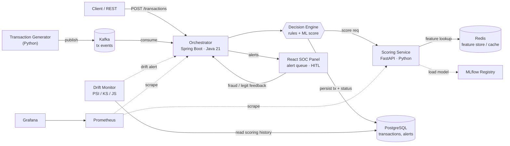

# FraudFort

**Real-time transaction fraud detection — hybrid rules + ML, Kafka streaming, SOC analyst panel.**

A portfolio project demonstrating a production-shape fraud detection system for FinTech / banking:
a Spring Boot orchestrator, a Python ML scoring service, Kafka streaming, MLflow-tracked models with
drift monitoring (PSI/KS/JS), Prometheus/Grafana observability, Docker Compose for local development
and Kubernetes manifests for deploy.

---

## Architecture



**Flow:** transactions arrive via REST or from the synthetic generator over Kafka → the orchestrator
runs the decision engine (hybrid rules + ML score from the scoring service) → status (APPROVED /
REVIEW / BLOCKED) plus the reason is persisted to PostgreSQL → REVIEW/BLOCKED items land in the
SOC analyst queue for human review → analyst feedback closes the loop. A drift monitor watches
scoring distributions over time and raises alerts when distributional drift exceeds threshold.

---

## Roadmap

| Stage | Scope | Status |
|---|---|---|
| 1 | Monorepo, Compose (Postgres + Redis), Spring Boot skeleton, Transaction entity + Flyway, POST/GET `/transactions`, integration tests | **in progress** |
| 2 | FastAPI scoring service + placeholder model, orchestrator → scoring call, dockerize | planned |
| 3 | Decision engine: rules + ML score → APPROVED / REVIEW / BLOCKED + reason | planned |
| 4 | Kafka streaming, synthetic transaction generator, orchestrator consumer + alerts | planned |
| 5 | React SOC analyst panel (alert queue, transaction detail, HITL feedback) | planned |
| 6 | Redis feature store (per-card/customer aggregates), latency measurement | planned |
| 7 | MLflow model registry integration, drift monitor service (PSI/KS/JS) | planned |
| 8 | Prometheus + Grafana dashboards, Kubernetes manifests | planned |

---

## Tech stack

| Layer | Choice |
|---|---|
| Orchestrator | Spring Boot 3.5 · Java 21 · Gradle (Kotlin DSL) |
| Scoring service | FastAPI · Python 3.12 · uv |
| ML model | scikit-learn · XGBoost · SHAP · Optuna (integrated at stage 7) |
| Storage | PostgreSQL 16 · Redis 7.4 |
| Migrations | Flyway 10 |
| Streaming | Apache Kafka (KRaft mode) |
| Frontend | React 18 · TypeScript · Vite |
| MLOps | MLflow registry · drift monitor (PSI/KS/JS) |
| Observability | Prometheus · Grafana |
| Testing | JUnit 5 + Testcontainers · pytest · Vitest + RTL |
| Local dev | Docker Compose v2 |
| Deploy target | Kubernetes |

---

## Quick start

> Status: stage 1 in progress. After stage 1 lands, the orchestrator + Postgres + Redis are runnable.

```bash
# 1. Copy environment defaults
cp .env.example .env

# 2. Bring up infra (Postgres + Redis)
docker compose up -d

# 3. Run the orchestrator (from services/orchestrator/)
./gradlew bootRun

# 4. Health check
curl http://localhost:8080/actuator/health

# 5. Create a transaction
curl -X POST http://localhost:8080/api/v1/transactions \
  -H "Content-Type: application/json" \
  -d '{"cardId":"4111111111111111","customerId":"c-001","amount":129.90,"currency":"EUR","merchantCategory":"5411","country":"PL","deviceId":"dev-abc","timestamp":"2026-06-10T12:34:56Z"}'
```

---

## Project layout

```
FraudFort/
├── docs/
│   ├── architecture.md          # high-level design
│   ├── runbook.md               # local dev commands
│   └── adr/                     # architecture decision records
├── services/
│   ├── orchestrator/            # Spring Boot — main API + decision engine
│   ├── scoring/                 # FastAPI — ML scoring                 [stage 2]
│   ├── tx-generator/            # synthetic transaction producer       [stage 4]
│   ├── drift-monitor/           # PSI/KS/JS drift detection            [stage 7]
│   └── frontend/                # React SOC analyst panel              [stage 5]
├── infra/
│   ├── prometheus/                                                  # [stage 8]
│   ├── grafana/                                                     # [stage 8]
│   └── k8s/                                                         # [stage 8]
├── shared/contracts/            # OpenAPI specs (Transaction, ...)
├── ml/                          # MLflow integration                    [stage 7]
├── docker-compose.yml
├── .env.example
└── README.md
```

---

## Development conventions

- **Commits:** [Conventional Commits](https://www.conventionalcommits.org/), atomic per change.
- **ADRs:** every non-obvious architectural decision is recorded in `docs/adr/` (Context · Decision · Consequences).
- **Tests:** JUnit 5 with Testcontainers (real Postgres, not mocks) for Spring; pytest for Python; Vitest + RTL for React.
- **Line endings:** LF enforced via `.gitattributes` for Windows/Linux parity.

---

## License

MIT (to be added).
